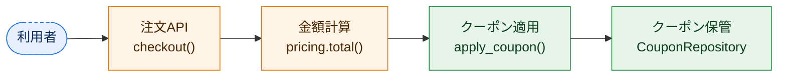
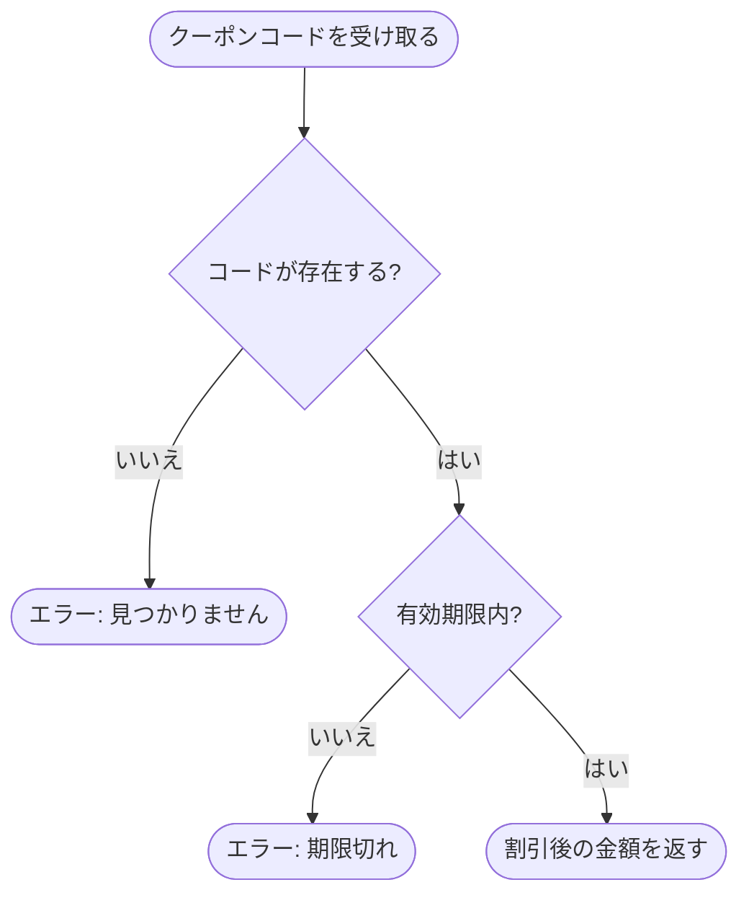
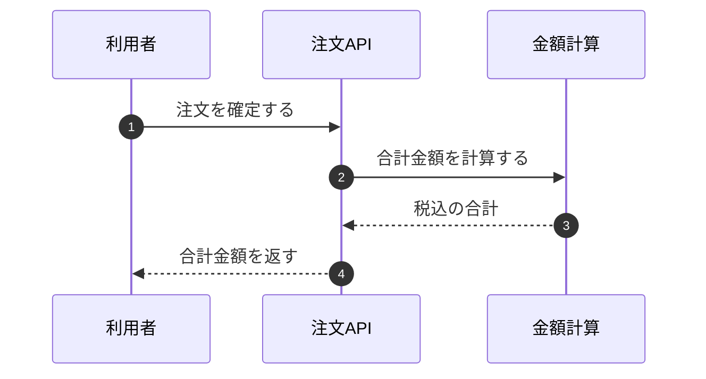

# Diagrams (Mermaid)

Draw a diagram only when it conveys in one look what prose needs three reads for. No decorative diagrams. One diagram answers one question (e.g. "on checkout, what is called in which order?").

## Which diagram where

| Page | Diagram | Question it answers | Mermaid type |
|---|---|---|---|
| index.md | 全体図 | where in the system the change sits | `flowchart LR` |
| flow.md | happy path | who calls what, in which order | `sequenceDiagram` |
| flow.md | branches/failures | which condition returns what | `flowchart TD` |
| flow.md | state (if any) | how data changes state | `stateDiagram-v2` |
| design.md | components | dependencies and responsibility boundaries | `flowchart LR` |
| design.md | data model (if DB changed) | tables and fields | `erDiagram` |
| review.md | impact chain (optional) | how a change reaches unchanged code | `flowchart LR`, ≤5 nodes |

Required: index overview, the two flow diagrams, design components. Optional diagrams only if they answer something the text and other diagrams do not. For changes without flow/structure (config, dependency bump, wording), write `該当なし` + reason in that section instead of drawing; an empty diagram is worse than none. If the components diagram would only repeat the index overview, write `該当なし（index の全体図と同じ）`.

## Readability rules

- **Size**: flowcharts ≤12 nodes (end and error nodes count), sequence diagrams ≤6 participants. Otherwise split or merge (e.g. one end node `エラーを返す`, details in a table below).
- **Labels in Japanese** that say what happens (`クーポンを検証`, not `処理A`). Function names on a second line: `A["クーポンを検証<br/>apply_coupon()"]`.
- **Direction**: overview/components left→right (LR), branches top→down (TD). Never mix within a diagram.
- **Draw failure paths** in branch diagrams; end nodes say what is returned.
- **Color new/changed/existing/external** (overview and components) with the classDefs below.
- Right after every diagram:

  ```markdown
  **この図で分かること:** <the question this diagram answers and its answer, 1–2 sentences>
  ```

  For colored diagrams add the legend line: `凡例: 緑=新規 / 橙=変更 / 灰=既存 / 青の破線=外部`
- Sequence diagrams use `autonumber`, and the numbered prose matches the numbers.

## Colors (paste as is)

```
classDef new fill:#e6f4ea,stroke:#1e8e3e,color:#0b3d1a
classDef changed fill:#fff4e5,stroke:#e37400,color:#4a2600
classDef existing fill:#f1f3f4,stroke:#80868b,color:#202124
classDef external fill:#e8f0fe,stroke:#1a73e8,color:#0b2a5c,stroke-dasharray:4 3
```

Usage: `class A,B new`.

## Syntax rules (break them and the diagram does not render)

- Node IDs: ASCII letters, digits, underscore (`api`, `coupon_repo`). Never reserved words (`end`, `graph`, `class`).
- **Always double-quote flowchart labels**: `A["ラベル"]`, `B{"条件?"}`, `C(["終了"])`.
- No double quotes inside labels (use 「」); no `#` or `;`.
- Edge labels: `-->|はい|`.
- No `;` or `#` in sequence messages.
- One definition per line.
- Subgraphs: `subgraph id ["見出し"]` … `end`.

## Examples

### Overview



### Branches and failures



### Happy path


